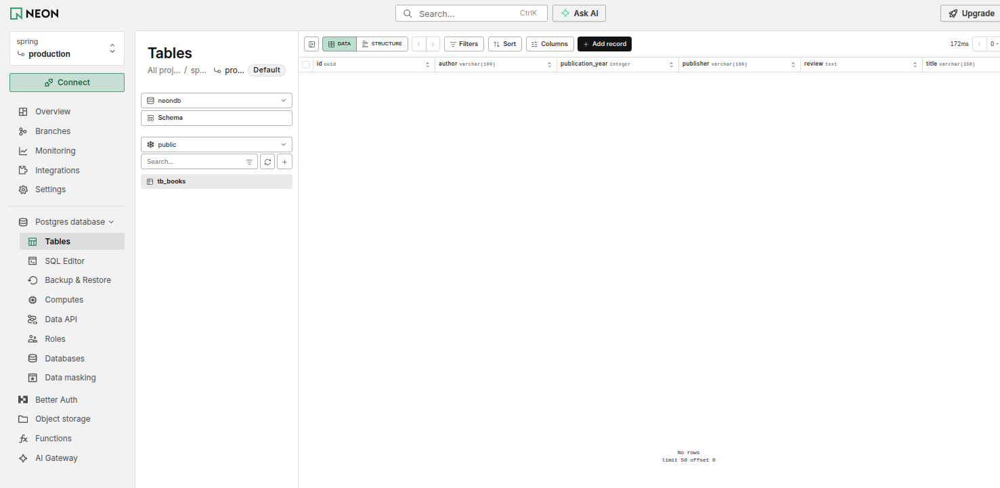

## Eu iniciei o spring boot com um video de 2022 de proposito e aqui eu vou te mostrar o porque
No meu repo spring-boot-mvc eu fiquei ate com dor no dedo de tanta pesquisa e digitação, erros de java antigo, foruns de reddit e ate um Q de stackoverflow eu me encontrei olhando; Agora esse é da mesma professora e é bem recente foi lançado faz 1 mês (18/08/2026) e como TODA internet ela não fez diferente, está usando IA (Veja bem eu não sou contra IA tenho ate amigos que são vibecoders, ja trabalhei em empresa vibecoder e sou obrigado a falar que aprendi muito com isso, os pós e contras... tem uns entusiastas/evangelizadores de IA né a maioria são e nem sabe; IA ACIMA DE TUDO, DEUS ACIMA DE TODOS é mais ou menos por ai) link da aula ta anexado ali no cantinho; cara eu to nos 15 minutos de aula e ja da pra perceber como a IA fez ela falar muito mas não falar quase nada ao mesmo tempo, se você for fazer uma comparação direta com o video de spring boot dela de 4 anos atrás a explicação foi muito mais com muito menos, teve foco, teve conceito, agora ela me chega com meio tonelada de slides bonitos (aqueles com cheiro de Claude Design) e mal conseguiu explicar coque é um Bean, nem mencionou IoC; Enfim... isso eu ja sei né kkk bom, breve desabafo sobre AI Slop. vamos seguir a aula
# Estão normalizando pagar para programar, e isso, é engraçado
Bom eu sempre fui acostumado a receber para programar kkk agora a senhorita, muito simpatica, inclusive, usa o claude code para programar esse "curso completo" de spring 2026... bom ja sei no que vai da, eu vou ficar assistindo a ia fazer o projeto inteiro, bom, vamos lá...

## O GRANDE IAAAAA também fez sua entrada triunfal

Eu só precisei mandar um prompt e o Codex foi útil pra achar o `urlXXX` que estava no lugar do endereço do Neon, acertar a conexão e rodar a aplicação com o Java 25. Olha o resultado: a tabela `tb_books` apareceu no banco.

Evidentemente, sem o GRANDE IAAAAA eu JAMAAAAAAAAAAIS conseguiria trocar uma URL, escolher o Java certo e conferir uma tabela no Neon. Ainda bem que ele apareceu para salvar a humanidade desse desafio impossível. kkk

# Notas sobre a aula completa
Teve duas coisas interessantes que ela não mostrou na aula de 2022 e uma delas eu tinha reclamado na outra aula inclusive, que é o uso de variavel ambiente; Acho que isso é a unica coisa que vou elogiar e também o uso de versionamento
para a API; Fora isso ela parecia ate impressionada com o Claude fazendo tudo que ela mandava a partir de skill e prompts, e foi aqui, que ela pecou... A aula era sobre o novo spring e spring IA e ela e na minha opnião ela focou mais
em vibecoding com claude cli do que em ensinar o framework, ela não falou sobre IoC mal falou o que é DispatcherServlet apenas disse o nome e usou porcamente o claude... faltou arquivos essenciais para o desenvolvimento de sistemas seguros guiado
por IA como PRD, TechSpecs, Hardening/Security, fora que, a skill esta bem mal feita, faltou ensinar a usar o CAVEMAN para economia de tokens, RTK para economia de uso de ferramentas do sistema operacional; E ela ainda ensina a usar o MCP do
neon, cara... MCP é uma maquina de consumir tokens, totalmente desnecessario enquanto a gente tiver que pagar por token MCP é aquele cara descenessario da empresa que todo patrão empurra só para dizer que tem, nem ele, nem o patrão, nem os colegas de trabalho
gosta muito dele, é mais demorado, consome tokens para um caralho e de quebra, se a IA estiver fora ou acabar seu plano de pobre melhorado do claude/codex ai fudeu né, tu não sabe nem usar o serviço externo, porque não preparou uma API estava usando MCP.
ela usou .env e não deixou no .gitignore, não falou nada sobre .env-example, enfim esse eu coloquei aqui no meu projeto da aula, porque é um absurdo ela estar profissionalizando pessoas sem o minimo da segurança né, né? eu to sendo radical? 
eu realmente não sei, eu sei que ela poderia ter evitado isso tudo se não tivesse usado o claude que eu nem sabia sobre o uso disso em aula, não falou no titulo e tivesse usado de verdade o spring AI, ela usou o basico do basico mesmo, pior que isso
so cors com *, e advinha... enfim vocês perceberam o repositories? não tem código nenhum lá, oque aconteceu? esqueceu de falar pro claude? esse é o problema de ter usado IA como ela usou, o problema não é a IA construir o sistema, isso ai vai 
acontecer ja trabalhei em empresas que usam claude ate pra responder a esposa... o problema é que do jeito que ela fez o claude ficou limitado a capacidade intelectual dela... o repository ta la vazio, nem sei pra que foi criado, coisa que não aconteceu
na aula de 2022. por fim, minha impressão é que foi uma aula feita as pressas para surfar nesse hype de "OLHA GENTE A IA SABE FAZER SISTEMAS" cara isso não é novidade pra quem entende de computação! me poupe...
